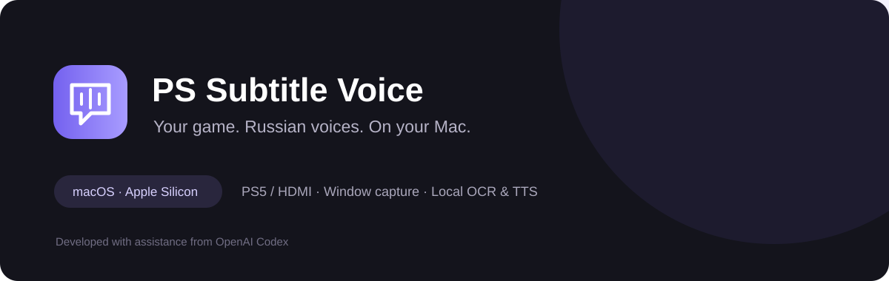

# PS Subtitle Voice

**Озвучивание игровых субтитров на Mac — локально, с PS5 через карту захвата или из окна браузера.**

**Local game subtitle narration on Mac — capture PS5 through HDMI hardware or a browser window.**

[Скачать для macOS / Download](https://github.com/Kamradi/PSSubtitleVoice/releases/latest) · [Русская инструкция](README_RU.md) · [English guide](README_EN.md) · [Build from source](docs/BUILD.md)

## Что умеет / Features

- Распознавание русских и английских субтитров с Apple Vision / Russian and English subtitle OCR with Apple Vision.
- Пять русских голосов Silero, английское произношение названий, числа по-русски / Five Russian Silero voices, English names, Russian numbers.
- Голоса по именам персонажей, мужской/женский голос по умолчанию и сохранение голоса в продолжении / Named-character voices, name-based male/female defaults and speaker continuity.
- Режим выбора голоса по исходному звуку и экспериментальное обучение персонажам / Source-audio voice selection and experimental character enrollment.
- Локальный перевод английских субтитров на русский в macOS 15+ / Offline English-to-Russian translation on macOS 15+.
- Отдельные профили игр, подвижное окно настройки области, защита от повторов / Game profiles, movable region controls and duplicate suppression.

## Начало работы / Getting started

1. Скачайте DMG в **Releases** и перенесите приложение в **Applications**. / Download the DMG from **Releases** and drag the app to **Applications**.
2. Разрешите доступ к карте или записи экрана. / Allow capture-card or screen-recording access.
3. Выберите источник, проверьте область субтитров и нажмите **Начать захват**. / Select a source, check the subtitle region and click **Начать захват** (Start capture).

Готовая сборка предназначена для **Mac с Apple Silicon, macOS 13+**. Для перевода нужна **macOS 15+** и предварительная загрузка языков Apple. Интерфейс переключается между русским и английским в настройках. Публичная сборка подписана ad hoc, **не нотарифицирована Apple**; порядок первого запуска описан в инструкции.

The ready-to-use build targets **Apple Silicon Macs running macOS 13+**. Translation requires **macOS 15+** and an initial Apple language download. The interface supports Russian and English; choose the language in Settings. The public build is **ad-hoc signed, not Apple-notarized**; see the installation guide.

В релиз включён профиль **«ГТА 6»** с готовыми настройками. При обновлении существующие настройки сохраняются.

The release includes a **“ГТА 6”** starter profile. Updates preserve existing settings.

## Приватность / Privacy

Изображение и звук обрабатываются на Mac; приложение не отправляет их в облако и не содержит аналитики. Журнал хранится локально и может содержать распознанные реплики. Интернет требуется для получения приложения/моделей и первой загрузки языков перевода.

Images and audio are processed on the Mac; the app does not upload them or include analytics. Local logs may contain recognized dialogue. Internet is needed to obtain the application/models and initially download translation languages.

## Лицензии / Licenses

Исходный код приложения — [MIT](LICENSE). Модели и зависимости имеют **отдельные лицензии**, включая некоммерческие ограничения Silero TTS и audEERING. MIT не распространяется на эти веса. См. [THIRD_PARTY_NOTICES.md](THIRD_PARTY_NOTICES.md).

Application source code: [MIT](LICENSE). Models and dependencies retain **their own licenses**, including noncommercial restrictions on Silero TTS and audEERING weights. These weights are not relicensed under MIT. See [third-party notices](THIRD_PARTY_NOTICES.md).

## Разработка / Development

**Разработано при участии OpenAI Codex:** прототипирование, реализация, отладка и подготовка документации. Приложение не использует OpenAI API для распознавания, перевода или озвучивания.

**Developed with assistance from OpenAI Codex:** prototyping, implementation, debugging and documentation. The application does not use OpenAI APIs for OCR, translation or speech synthesis.

Независимый проект; не связан с Sony, PlayStation или Rockstar Games. / Independent project; not affiliated with Sony, PlayStation or Rockstar Games.
